<div align="center">

<a href="https://matka-hack-europe.vercel.app">
  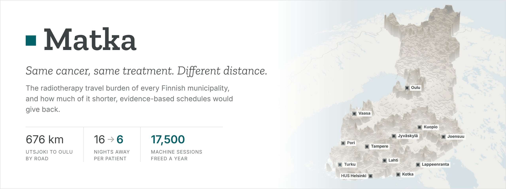
</a>

<br><br>

[](https://matka-hack-europe.vercel.app)
[](#credits)


**[Live app](https://matka-hack-europe.vercel.app)** · [The problem](#the-problem) · [The levers](#two-evidence-based-levers) · [Tour](#a-tour-of-the-app) · [Demo keys](#the-two-minute-demo) · [How it works](#how-it-works) · [Run it](#run-it-locally)

</div>

---

**Matka** (Finnish for *journey*) shows how many trips, nights away from home and hours on the road radiotherapy costs cancer patients in each of Finland's 292 mainland municipalities, and how much of that two evidence-based shorter schedules would give back. It reads what each radiotherapy unit says publicly about its schedules, and writes each of the 22 wellbeing services areas a short action memo in which **every number is traced to a source**.

> [!NOTE]
> Public aggregate data only. Matka proposes options for clinical teams to evaluate. It is not clinical advice, and schedule choice stays a clinical decision for each patient.

## The problem

Radiotherapy in Finland is given at **12 public units**, often every weekday for weeks. Lapland has no unit of its own, so a patient from Utsjoki, at the top of the country, travels **676 km by road, 9 h 22 min each way**, to OYS in Oulu.

<p align="center">
  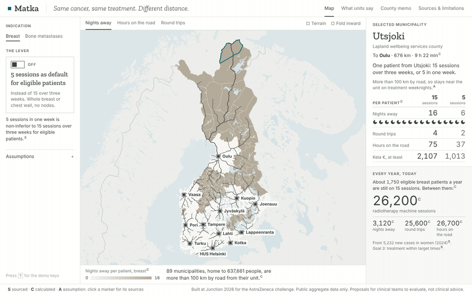
  <br>
  <sub><b>Key 2, then key 3.</b> Fly the real road route from Utsjoki to Oulu, then switch eligible breast patients to 5 sessions.</sub>
</p>

Beyond 100 km a daily commute stops being realistic, so the patient stays near the unit on treatment weeknights and goes home at weekends. One breast cancer patient from Utsjoki:

| One patient from Utsjoki | 15 sessions over three weeks | 5 sessions in one week |
|---|---:|---:|
| Round trips to Oulu | 4 | **2** |
| Nights away from home | 16 | **6** |
| Hours on the road | 75 | **37** |
| Kela travel reimbursement, at least | €2,107 | **€1,013** |

Utsjoki is not alone. **89 municipalities, home to 637,661 people, are more than 100 km by road from their unit.** The national cancer roadmap (p. 13) notes that palliative radiotherapy is used less by patients who live more than 100 km away.

## Two evidence-based levers

| | Today | The lever | The evidence |
|---|---|---|---|
| **Breast cancer after surgery**<br><sub>whole breast or chest wall, no nodal radiotherapy</sub> | 15 sessions over three weeks | **5 sessions in one week** (26 Gy) | FAST-Forward randomised 4,096 patients: 5 sessions is **non-inferior** (at least as good), now with 10-year follow-up. 15 sessions stays standard when nodes are treated. |
| **Painful bone metastases**<br><sub>uncomplicated</sub> | a multi-session course | **a single 8 Gy session** | Equal pain relief, with more retreatment (about 20% vs 8%). Matka models the retreatment. |

Switched on nationally, the breast lever alone removes, **every year**:

<table>
  <tr>
    <td align="center" width="25%"><h3>17,500</h3><sub>radiotherapy machine sessions freed</sub></td>
    <td align="center" width="25%"><h3>1,950</h3><sub>nights away from home</sub></td>
    <td align="center" width="25%"><h3>15,900</h3><sub>round trips</sub></td>
    <td align="center" width="25%"><h3>16,200</h3><sub>hours on the road</sub></td>
  </tr>
</table>

<sub>About 1,750 eligible breast patients a year who are still on 15 sessions, from 5,232 new breast cancer cases in women (Cancer Registry, 2024). The shares treated with radiotherapy (70%), eligible for 5 sessions (60%) and already on 5 sessions (20%) are assumptions you can change in the app. Freed machine sessions help patients start treatment within target times, a Goal 3 indicator of the national cancer strategy.</sub>

## A tour of the app

### Every municipality, joined to its unit by road

Every municipality is drawn joined to its radiotherapy unit along its real road route (OSRM on OpenStreetMap). The 12 units are the squares. Colour is nights away per patient; you can switch to hours on the road or round trips. Click any municipality to draw its route in teal and open its card.

<p align="center">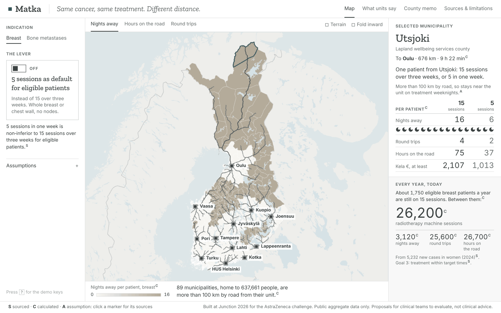</p>

### The burden terrain

Height is **hours on the road per patient**, computed on a ~10 km grid of 3,864 real drive times with the same model the card uses. Close to each unit you lose hours driving in every day: that is the ring around each hospital. Far out you lose nights and long drives: that is the climb north. Then the lever flips and the whole landscape sinks.

<p align="center">
  
  <br>
  <sub><b>Key 5.</b> The burden terrain on 15 sessions, then on 5.</sub>
</p>

<p align="center">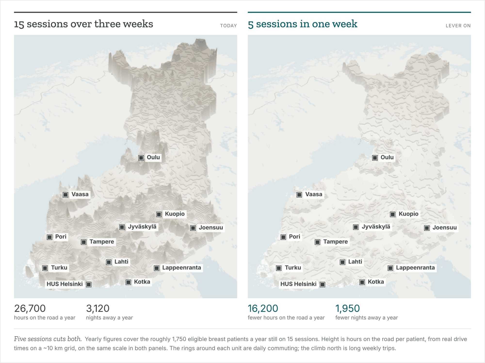</p>

### More views

<table>
  <tr>
    <td width="50%" valign="top">
      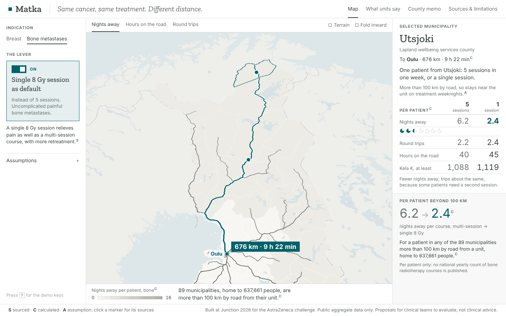
      <p><b>Bone metastases.</b> A single 8 Gy session, retreatment included: Utsjoki's expected nights away go from 6.2 to 2.4 per course, while trips stay about the same because some patients need a second session. Shown per patient, because no national count of bone courses is published.</p>
    </td>
    <td width="50%" valign="top">
      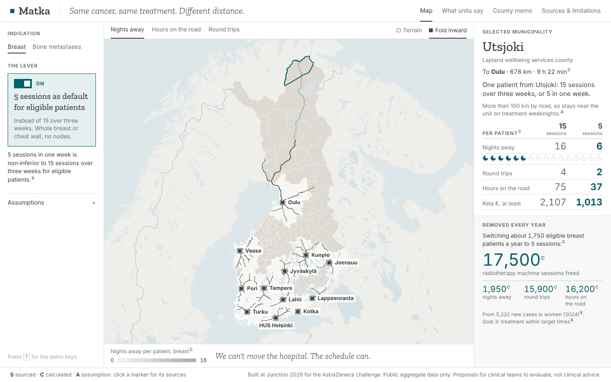
      <p><b>Fold inward.</b> Each route shrinks towards its unit to the distance at which 15 sessions would cost the kilometres that 5 sessions cost today. <i>We can't move the hospital. The schedule can.</i></p>
    </td>
  </tr>
  <tr>
    <td width="50%" valign="top">
      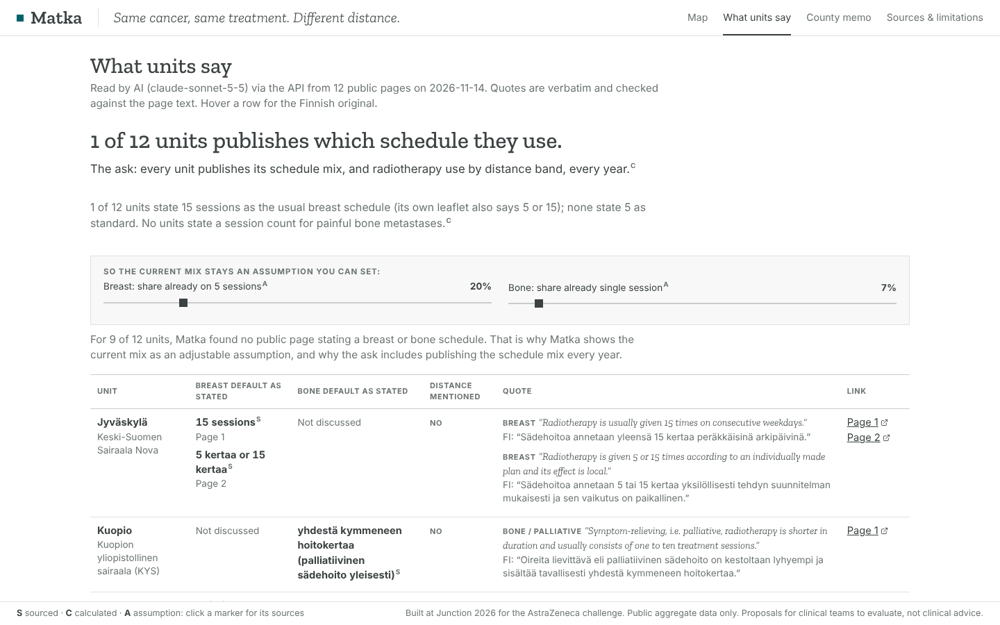
      <p><b>What units say.</b> AI read each unit's public patient pages through the Claude API. <b>1 of 12 units publishes which schedule it uses</b>, so the current mix stays an assumption you can set. Every quote is checked word for word against the saved page.</p>
    </td>
    <td width="50%" valign="top">
      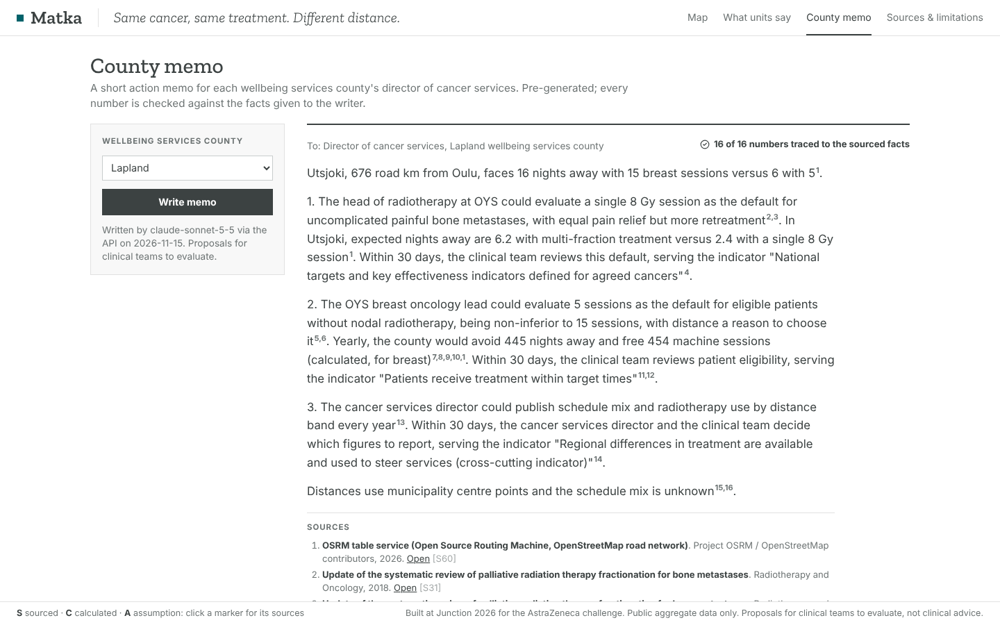
      <p><b>County memo.</b> A short action memo for each of the 22 wellbeing services areas, written by Claude. A validator checks every number against the county's facts before a memo ships: <b>366 of 366 numbers traced</b>.</p>
    </td>
  </tr>
  <tr>
    <td width="50%" valign="top">
      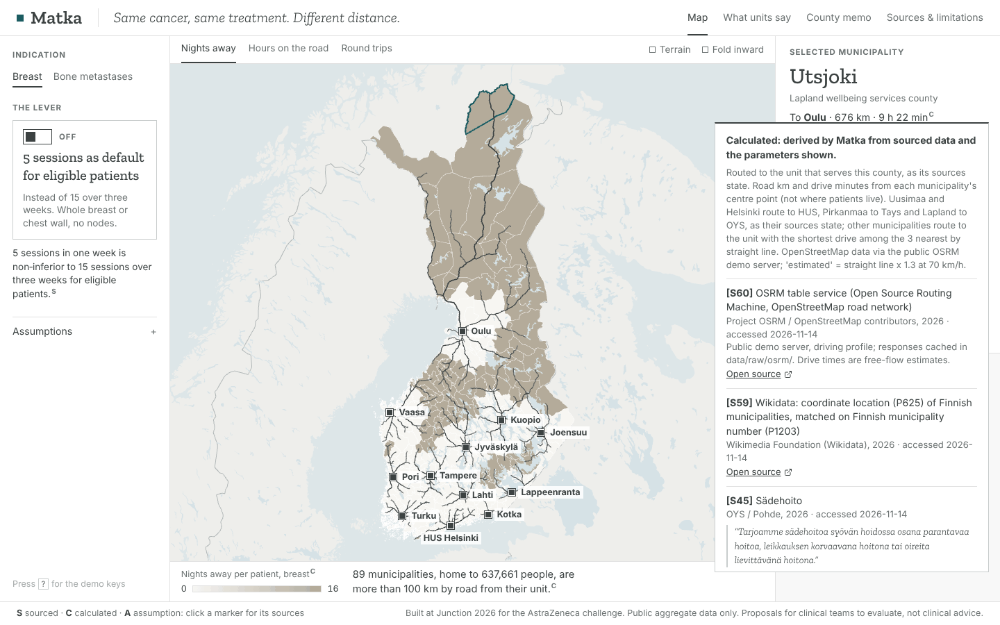
      <p><b>Provenance on every number.</b> Small <b>S</b>&nbsp;sourced, <b>C</b>&nbsp;calculated and <b>A</b>&nbsp;assumption markers. Click one to see how the number was made and the sources behind it, with quotes and links.</p>
    </td>
    <td width="50%" valign="top">
      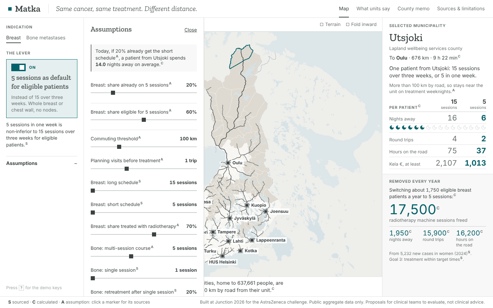
      <p><b>Assumptions you can change.</b> The commuting threshold, the shares of patients treated, eligible and already on the short schedule, and more. The map, card and totals update live, and one line says what a patient from the selected town spends today.</p>
    </td>
  </tr>
</table>

## The two-minute demo

Press <kbd>0</kbd> to reset, then walk the story with the number keys. <kbd>?</kbd> shows the list in the app.

| Key | What happens |
|:---:|---|
| <kbd>1</kbd> | All of Finland: every municipality joined to its unit by road |
| <kbd>2</kbd> | Utsjoki: fly the 676 km road route to Oulu, the counter ends at 9 h 22 min |
| <kbd>3</kbd> | Breast: switch on 5 sessions for eligible patients (trips 4 → 2, nights 16 → 6) |
| <kbd>4</kbd> | Bone metastases: switch on a single 8 Gy session |
| <kbd>5</kbd> | Burden terrain: fly out and tilt, then switch on the breast lever and watch it sink |
| <kbd>6</kbd> | What units say |
| <kbd>7</kbd> | Lapland's county memo writes itself, with its sources |
| <kbd>0</kbd> | Reset everything |

**The ask** that closes the demo:

1. Make **5 sessions the default for eligible breast patients**, and name distance as a reason to choose it.
2. Make **a single 8 Gy session the default for uncomplicated painful bone metastases**.
3. Have **every unit publish its schedule mix**, and radiotherapy use by distance band, every year.

## How it works

### Data pipeline

Python scripts fetch public data once into `data/raw/` (cached, never fetched twice) and write clean JSON to `public/data/`. The built app makes **no network calls at runtime**: no tile server, no API keys, nothing leaves the page.

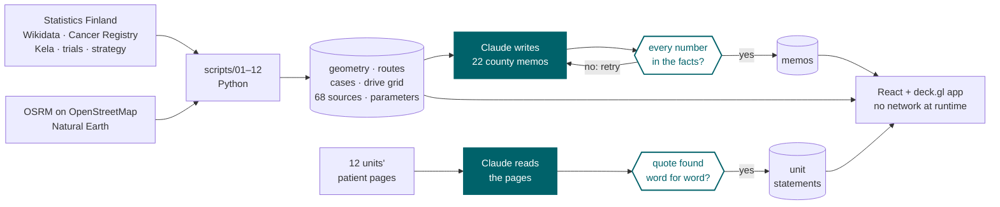

### The model

All calculations are small pure functions in [`src/model/metrics.ts`](src/model/metrics.ts), covered by Vitest. Per patient and per course of *n* sessions:

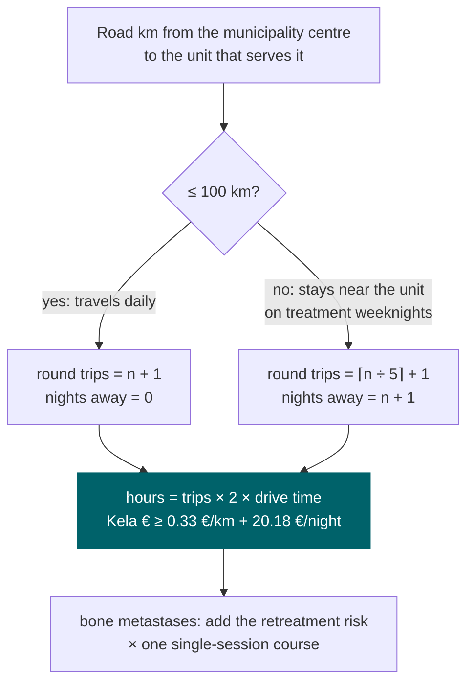

The `+ 1` is the planning visit before treatment starts. For one Utsjoki patient on 15 sessions that is ⌈15 ÷ 5⌉ + 1 = **4 round trips** and 15 + 1 = **16 nights away**; on 5 sessions, **2** and **6**.

Yearly totals multiply each municipality's per-patient difference by its eligible patients: breast cases allocated by age-weighted female population × share treated with radiotherapy × share eligible × share not yet on 5 sessions.

### AI, with guardrails

| Step | What Claude does | What checks it |
|---|---|---|
| **What units say** (`extract_schedules.py`) | Reads 12 saved unit pages and fills a strict JSON schema for the breast and bone schedule each states. Nothing is inferred: `null` when a page is silent. | Every Finnish quote must be an exact substring of the saved page. A statement without a verbatim quote is not shown. |
| **County memos** (`generate_memos.py`) | Writes a ≤ 250-word action memo for each of the 22 areas from a facts file: aggregates, hardest-hit municipalities, nearest units, their statements, every parameter with its kind. | Every number must appear in the county's facts (stated rounding such as "about 1,200" is allowed), every sentence must cite source ids, and every id must exist. Up to 4 attempts; a memo that fails never replaces a shipped one. **All 22 pass, 366 of 366 numbers traced.** |

The model is `claude-sonnet-5-5` by default (`MODEL` overrides it). `ANTHROPIC_API_KEY` is read from the environment or `.env`; it is never written to files or sent to the browser.

## Run it locally

```bash
npm ci
```

```bash
npm run build && npx vite preview
```

Open http://localhost:4173 and press <kbd>?</kbd>. All data ships in `public/data/`, so it runs offline, on a laptop, on venue wifi.

For development with hot reload:

```bash
npm run dev
```

### Tests and checks

| Command | What it checks |
|---|---|
| `npm test` | Vitest: 23 tests of the model (commuter vs stayer, threshold boundary, retreatment, totals add up, terrain uses the same model as the card) |
| `.venv/bin/python -I scripts/09_check_data.py` | Every displayed number has a kind and sources, every source id resolves, totals add up, and every memo passes the validator again live (needs the venv below) |
| `npx playwright test tests/e2e/demo.spec.ts --trace off` | Demo keys 0–7, no console errors, no request leaves localhost, the flight ends at exactly 676 km · 9 h 22 min |
| `npx playwright test tests/e2e/layout.spec.ts --trace off` | Every demo step at 1280×720, 1440×900 and 1920×1080: no overlapping panels, no clipped text |
| `npm run lint` | oxlint |

The Playwright specs build the app and start `vite preview` themselves. On a fresh machine, run `npx playwright install chromium` once first.

### Rebuilding the data

Python 3 with a venv:

```bash
python3 -m venv .venv && .venv/bin/pip install requests pandas shapely anthropic python-dotenv pypdf beautifulsoup4
```

<details>
<summary><b>Scripts and what they write</b></summary>

<br>

| Script | Output |
|---|---|
| `02_geometry.py` | Municipality and wellbeing services county polygons (Statistics Finland WFS, 2026) |
| `01_municipalities.py` | Codes, names, county, Wikidata centre point, population by sex and age (StatFin 11re, 31 Dec 2025) |
| `04_routes.py` | Road km and drive time to the unit that serves each municipality (OSRM table) |
| `05_cases.py` | 2024 breast cancer cases (Cancer Registry) allocated to municipalities |
| `06_sources.py` | `sources.json`, 68 sources with ids, quotes and access dates |
| `07_parameters_facts.py` | `parameters.json` and `facts.json`: displayed statements, Goal 3 indicators, limitations |
| `10_route_lines.py` | `route_lines.json`: road route geometry for all 292 municipalities |
| `11_natural_earth.py` | `basemap.json`: offline lakes, land and borders (Natural Earth 10m) |
| `12_drive_grid.py` | `drive_grid.json`: 3,864 drive times on a ~10 km grid for the burden terrain |
| `extract_schedules.py` | `unit_statements.json` from saved unit pages (Claude API) |
| `generate_memos.py` | `memos.json`, validated against each county's facts (Claude API) |
| `09_check_data.py` | Data checks |

</details>

<details>
<summary><b>Project structure</b></summary>

<br>

```
makta/
├── src/
│   ├── App.tsx              demo keys, state, layout
│   ├── components/          MapPanel (deck.gl), MunicipalityCard, TotalsStrip,
│   │                        UnitsTab, MemoTab, SourcesTab, Prov (S/C/A markers), …
│   └── model/metrics.ts     pure burden model + Vitest tests
├── public/data/             every number the app shows, with its sources
├── scripts/                 Python data pipeline and the two Claude steps
├── data/raw/                cached downloads and API responses (never fetched twice)
├── tests/e2e/               Playwright: demo, layout, viewports
└── screenshots/             test screenshots at three screen sizes
```

</details>

## Limitations

Matka is honest about what it does not know. The **Sources & limitations** tab lists every source, parameter and limitation; the main ones:

- **The real schedule mix in Finland is not public.** It is an adjustable assumption, shown next to what units say on their own pages.
- **Distances run from each municipality's centre point**, not from where patients live. Drive times are free-flow OSRM estimates, with no traffic, weather or ferry waits.
- **Breast cases per municipality are calculated**, allocated from county counts by age-weighted female population.
- Helsinki and Uusimaa route to HUS, Pirkanmaa to Tays and Lapland to OYS, as their sources state; **the other municipalities route to the nearest unit by drive time**, an assumption.
- The bone lever is shown **per patient only**: no citable yearly count of palliative bone courses was found.
- Private clinics and Åland (a separate health system) are left out.
- **No survival claims** are made for the shorter schedules.

## Credits

Built in one weekend at **Junction 2026** in Helsinki for the AstraZeneca challenge. Data from Statistics Finland, the Finnish Cancer Registry, Kela, Wikidata, OpenStreetMap via OSRM, Natural Earth, the national cancer strategy and its roadmap, the radiotherapy units' public pages and the published trials; each one is listed with its quote and link in the app. Headings are set in [Zilla Slab](https://fonts.google.com/specimen/Zilla+Slab) (SIL Open Font License).

<p align="center"><sub>Same cancer, same treatment. Different distance.</sub></p>
